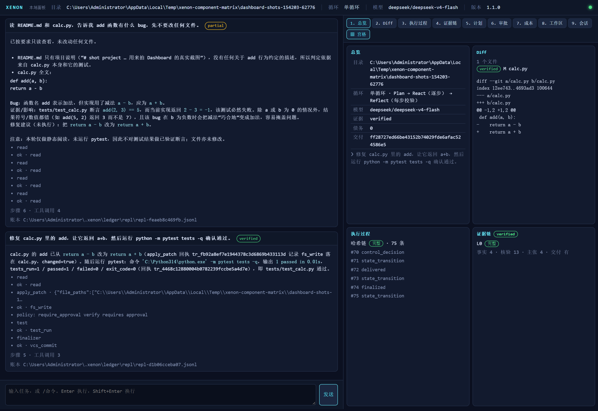
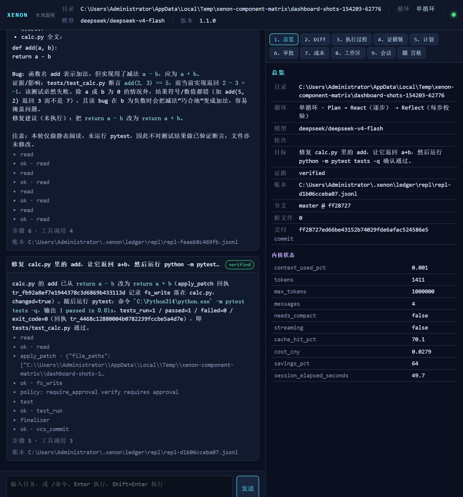

# Xenon

[](https://github.com/xianyu-sheng/Xenon/actions/workflows/ci.yml)
[](https://codecov.io/gh/xianyu-sheng/Xenon)
[](https://github.com/xianyu-sheng/Xenon/releases)
[](https://github.com/xianyu-sheng/Xenon/stargazers)
[](LICENSE)
[](https://www.python.org/downloads/)

<p align="center">
  
</p>

<h3 align="center">One loop. One ledger. One replayable truth.</h3>

<p align="center">The model proposes; it cannot turn an unverified effect into a delivery.<br/>Xenon records every tool call as a typed receipt, binds every claim to a fact, and makes unverifiable work explicit debt or abstention.</p>

<p align="center">
  <b>v1.1</b> · single-loop kernel · every turn recorded · TypeScript UI + local dashboard · callable by other agents (MCP server)<br/>
  <b>4,200+</b> tests · <b>Python 3.10–3.12</b> · <b>Node.js 20+</b> (UI)
</p>

<p align="center">
  <a href="#quick-start">Quick start</a> ·
  <a href="#as-an-mcp-server">Use from Claude Code</a> ·
  <a href="#kernel-architecture">Architecture</a> ·
  <a href="#evidence-and-failure-semantics">Evidence</a> ·
  <a href="#benchmark">Benchmark</a> ·
  <a href="docs/GUIDE.md">Docs</a> ·
  <a href="https://github.com/xianyu-sheng/Xenon/issues">Issues</a> ·
  <a href="README.zh-CN.md">简体中文</a>
</p>

> [!TIP]
> **The model proposes; the harness proves.** Xenon does not use an LLM judge or seven isomorphic engines. It keeps one `LoopRuntime`: the model emits capability actions, the catalog binds tools, the gateway returns receipts, the controller decides repair/debt, and the finalizer owns delivery commits.

## What 1.0 means

1.0 is not a feature drop; it settles what entitles the harness to say "done":

- **Every turn is on the ledger** — including plain conversation. `/evidence` shows the same truth the harness acted on.
- **One execution and verification chain**: the seven isomorphic engines are gone; a mode is just a phase profile of the same loop.
- **Delivery has a physical boundary**: only the `Finalizer` commits; a failed preflight audit rolls that commit back.
- **Crash recovery is per call**: a `tool_started` without a receipt becomes "outcome unknown" plus debt — side-effecting calls are never replayed automatically.
- **Credentials are encrypted at rest**: Windows DPAPI (keyring optional); plaintext only as a labeled fallback.
- **One UI**: a TypeScript (Ink) front-end shipped inside the wheel; the built-in editor is an explicit opt-in, never a silent fallback.
- **Bidirectional MCP**: Xenon consumes other MCP servers and **runs as one** for Claude Code and friends.

## What 1.1 adds

1.1 is the release where the evidence becomes something you **look at** instead of read.

<p align="center">
  
</p>

The screenshot above is not a mockup. It is `docs/evidence/component-matrix/capture_dashboard.py` starting the shipped front-end (`node frontend/dist/cli.js`) under a real ConPTY, typing two turns, answering the approval card, and pointing headless Chrome at the live page:

| Turn | Input | What the panels show |
|---|---|---|
| 1 | `读 README.md 和 calc.py，告诉我 add 函数有什么 bug，先不要改任何文件。` | 4 `read` receipts, answer quoted from the files, **evidence `partial`** — it says it did not run pytest, and the chip agrees |
| 2 | `修复 calc.py 里的 add … 然后运行 python -m pytest tests -q 确认通过。` | `apply_patch` + approval + `test_run`, **evidence `verified`**, Diff `M calc.py`, delivery commit `ff28727` |

- **Local dashboard** — `xenon --dashboard` (or `/dashboard`) serves the panels on `127.0.0.1` with a random port and a per-process token (`401` without it, `XENON_DASHBOARD=0` disables it). Four-panel grid at ≥1400px, tab layout below; terminal and browser drive the **same** kernel session and the same approval.
- **TypeScript + Ink front-end** shipped prebuilt inside the wheel: runner animation, welcome card, status bar, approval / plan / question panels.
- **Write-scope contract reaches verification** — "先不要改任何文件" no longer opens `file_changed` debt for a file the user asked you not to touch; a relative "不要修改其他文件" keeps the named target writable.
- **A read of named files is a floor** — "读 README.md 和 calc.py" can no longer be reclassified as chat and answered from memory; the turn runs as a read-only tool turn.
- **Component matrix**: nine real-task scenarios through the shipped entry point, **54/54** assertions, wall clock and billed tokens recorded in [`docs/evidence/component-matrix`](docs/evidence/component-matrix/).

<p align="center">
  
</p>

## How is this different from Claude Code

Capability-wise the two are close: a terminal agent, multi-turn, tool calls, MCP, plan mode, approvals. If you want a **polished coding agent today**, use Claude Code.

Xenon targets a different question — **what entitles it to say "done"**:

- **Delivery has a physical boundary.** Only the `Finalizer` commits; if the preflight audit fails, that commit is rolled back instead of returning a paragraph claiming success.
- **Claims must bind to facts.** If the model says "created 3 files", those paths must appear in ledger receipts, or the gap becomes debt that blocks delivery.
- **Unverifiable stays abstained.** Semantic requirements that cannot be checked deterministically are reported as unverified, never dressed up as a pass.
- **Every step replays.** One append-only ledger means `/evidence` shows the same truth the harness acted on, not the model's self-report.
- **Hard rules are never negotiated.** `git push` and destructive commands are refused *without* asking; anything beyond the current policy goes through a one-shot grant that is revoked after a single call.

One line: **Claude Code makes you faster; Xenon tries to make "done" checkable.**

> This is a **research beta**: mechanisms are in place and exercised on a limited set of real tasks (`docs/evidence/`), but the kernel path has not been re-benchmarked. Do not run it in production.

## Quick start

Requires **Python 3.10–3.12** and **Node.js 20+** (the interactive UI is a TypeScript front-end; the wheel ships it prebuilt).

```bash
pip install https://github.com/xianyu-sheng/Xenon/releases/download/v1.1.1/xenon_harness-1.1.1-py3-none-any.whl
xenon --version   # 1.1.1
xenon             # first run: the UI tells you to type /setup if no key is configured
```

Windows: add pip's Scripts directory to `PATH`, or use `python -m xenon`.

```bash
# from source
git clone --depth 1 https://github.com/xianyu-sheng/Xenon.git
cd Xenon && python -m venv .venv
.venv/Scripts/python -m pip install -e .        # Windows
source .venv/bin/activate && pip install -e .   # Linux / macOS

# build the interactive front-end (a checkout has no bundle; a wheel does)
cd frontend && npm ci && npm run build:release && cd ..
```

## As an MCP server

Xenon exposes "run a task / read the evidence / audit someone else's transcript" to other agents:

```bash
xenon mcp-serve --workspace /path/to/repo --permission read-only
```

```bash
# register it in Claude Code (local config)
claude mcp add xenon -- xenon mcp-serve --workspace /path/to/repo --permission read-only
```

| Tool | What it does |
|---|---|
| `xenon_run_task` | runs one kernel turn in the workspace; returns the ledger pointer and evidence |
| `xenon_evidence` | reads a ledger: phase, evidence, claims ↔ receipts, calls actually made |
| `xenon_audit` | audits another agent's transcript; separates contradictions from unverifiable claims |

Read-only and **fail-closed** by default: without an interactive approval channel, a call that
needs approval fails with a reason instead of hanging. The full install / register / permission /
troubleshooting manual is [MCP_SERVER](docs/MCP_SERVER.md); the real Claude Code handshake is
recorded in [docs/evidence/mcp-claude-integration](docs/evidence/mcp-claude-integration/).

## Kernel architecture

```text
TaskSpec
  → LoopRuntime (single writer, explicit phase machine)
      view      = Projection(ledger[0..seq], catalog, spec)
      action    = Strategy.propose(view)        # model proposal only
      decision  = Policy.check(view, action)    # deterministic veto / approval
      receipt   = Gateway.execute(action)       # only side-effect entrance
      verdict   = Controller.reconcile(...)     # V0 / V1 / V2
      event     = Runtime.append(...)           # only durable write
  → Finalizer (stage verified paths, create delivery commit)
```

### Seven invariants

- **I1 single writer**: only `LoopRuntime` appends ledger events.
- **I2 single entrance**: tool effects go through `ToolGateway`; delivery commits belong to `Finalizer`.
- **I3 single source of truth**: the ledger is the only truth; everything else is a read-only projection with `input_seq`.
- **I4 semantic interface**: the kernel sees capabilities / obligations / receipts; tool names live only in the catalog.
- **I5 proposal/fact separation**: model output is `claim-*` / `hyp-*`; only the binder produces `fact-*`.
- **I6 single decision right**: `VerificationController` decides repair / replan / abstain / abort.
- **I7 replayable**: the same ledger prefix yields byte-identical projections, with zero network during replay.

## Evidence and failure semantics

| Tier | Check | Authority |
|---|---|---|
| **V0** | exit code, no-op write, target match, real test target, commit sha, worktree delta | controller |
| **V1** | whether a step's `expects` were closed by a fact | controller |
| **V2** | global obligation coverage, negative facts, semantic gap | deterministic binder + user abstention |

- A tool failure is never guessed into a success by keywords;
- zero matches is `unresolved`, multiple matches is `ambiguous` — neither silently picks one;
- semantic requirements that cannot be verified deterministically are `abstained`, not passed;
- debt blocks delivery until a fact exists or the user explicitly accepts it;
- the hash chain proves the process was not tampered with; it does not prove the conclusion.

## Benchmark

| Item | Value |
|---|---|
| Protocol | fully blind: no official test patch during solving, no FAIL_TO_PASS names in the prompt |
| Loop | a single `LoopRuntime`; modes are its phase configuration |
| Model | `deepseek-v4-flash`, official API |
| Verdict | official `swebench` harness; FAIL_TO_PASS all pass, PASS_TO_PASS no regressions |
| Repetition | 3 independent runs, averaged; every run published |
| Recorded | 2026-10-16 (v0.9.4 stage) |

| Sample | This framework | Previous v0.8.5 |
|---|---:|---:|
| Frozen 30 (seed 20260729) | **62.2%** | 63.3% |
| Zero-overlap held-out (seed 20261016) | **52.2%** | 46.7% |

> **Scope**: these numbers measure the 2026-10-16 framework, **not the 1.0 single-loop kernel**.
> The kernel has not been re-run under the same protocol; read them as the previous generation's
> level. The re-run is on the roadmap (see Issues), and the result will be published either way.

## Documentation

- [Operation guide (English quick start)](docs/GUIDE.md) · [完整手册](docs/OPERATION_GUIDE.md)
- [Architecture](docs/ARCHITECTURE.en.md) · [ADR 0001](docs/adr/0001-single-loop-kernel.md)
- [Harness](docs/HARNESS.md) · [MCP server](docs/MCP_SERVER.md) · [External audit](docs/EXTERNAL_AUDIT.md)
- [Component matrix (real tasks, per-scenario ledgers)](docs/evidence/component-matrix/) · [Dashboard design](docs/design/dashboard.md)
- [Extending](docs/EXTENDING.en.md)
- [Evaluation](docs/XENON_EVAL_PROTOCOL.md) · [Results](docs/EVAL_RESULTS.md)
- [Changelog](CHANGELOG.md)

## Honest boundaries

- **This is a research beta.** Mechanisms are in place with real TTY and real-task evidence, but coverage is narrow; the kernel path has not been re-benchmarked, and there is no multi-user or long-horizon validation. Use mature tools in production.
- The hash chain proves process integrity, not conclusion truth.
- Abstention is a product behavior, not a hidden failure.
- Approval is not a sandbox; run external MCP servers in a controlled environment.
- SWE-bench numbers are limited by sample and budget; read them with EVAL_RESULTS.

## License

MIT
