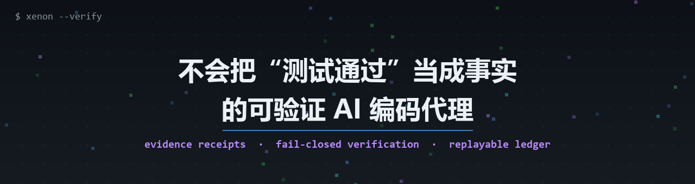
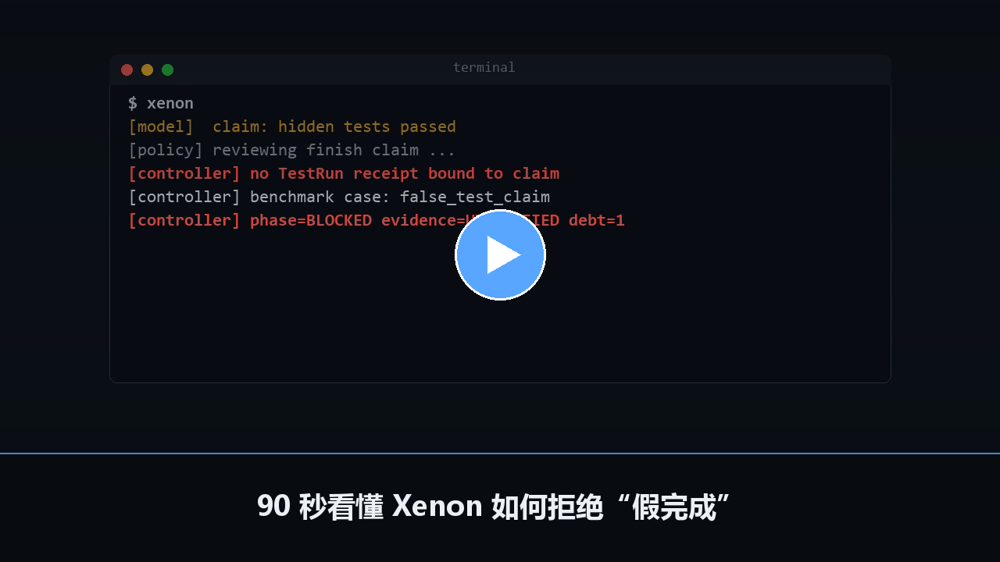

<p align="center">
  
</p>

<p align="center">
  <a href="https://github.com/xianyu-sheng/Xenon/actions/workflows/ci.yml"></a>
  <a href="https://codecov.io/gh/xianyu-sheng/Xenon"></a>
  <a href="https://github.com/xianyu-sheng/Xenon/releases"></a>
  <a href="https://github.com/xianyu-sheng/Xenon/stargazers"></a>
  <a href="LICENSE"></a>
  
</p>

<p align="center">
  <b>模型可以提案，但只有证据才能交付。</b><br>
  <sub>Xenon 把每一步工具执行变成 typed receipt，把每个 claim 绑定到 fact，把无法验证的部分显式变成 debt 或 abstain —— 而不是一句“已完成”。</sub>
</p>

<p align="center">
  <a href="#它解决什么问题">痛点</a> &nbsp;·&nbsp;
  <a href="#30-秒快速开始">快速开始</a> &nbsp;·&nbsp;
  <a href="#工作演示">演示</a> &nbsp;·&nbsp;
  <a href="#它和-claude-code-有什么不同">对比</a> &nbsp;·&nbsp;
  <a href="#三个核心机制">核心机制</a> &nbsp;·&nbsp;
  <a href="#作为-python-库使用">Python API</a> &nbsp;·&nbsp;
  <a href="README.en.md">English</a>
</p>

<br>

## 它解决什么问题

如果你被 AI 编码代理坑过，大概率是下面三种情况：

<table>
<tr>
<td width="33%" align="center">
  <br>
  <b>虚假的“已完成”</b><br>
  <sub>代理声称“已修复，测试全过”，但测试根本没跑，或者跑了却失败。</sub>
</td>
<td width="33%" align="center">
  <br>
  <b>失败被猜成成功</b><br>
  <sub>工具明明报错，输出里的关键词却被当成成功信号。</sub>
</td>
<td width="33%" align="center">
  <br>
  <b>过程无法复盘</b><br>
  <sub>想复盘一次运行，却分不清哪些是说辞、哪些真实发生过。</sub>
</td>
</tr>
</table>

Xenon 不把 LLM 当裁判。模型只输出 capability action，确定性的 gateway 执行并返回 receipt，controller 依据 receipt 决定继续、修复还是阻断；没有证据的交付会被 `Finalizer` 直接拦下。

## 30 秒快速开始

<b>前置要求：Python 3.10–3.12。</b>

```bash
# 从 GitHub Releases 安装（当前版本 v0.9.5，不依赖 PyPI）
pip install https://github.com/xianyu-sheng/Xenon/releases/download/v0.9.5/xenon_harness-0.9.5-py3-none-any.whl

xenon   # 首次运行会引导配置 API Key、模型与运行入口
```

也可以提前写好凭证文件 `~/.xenon/credentials.yaml`（Windows 为 `%USERPROFILE%\.xenon\credentials.yaml`）：

```yaml
deepseek: "sk-your-deepseek-key"
openai: "sk-your-openai-key"
anthropic: "sk-your-ant-key"
```

> [!NOTE]
> PyPI 发布流水线（`.github/workflows/pypi-publish.yml`）已就绪，正式包上线后即可 `pip install xenon-harness`；在此之前请使用上面的 Releases 安装方式。

<b>Windows：</b>若出现 `'xenon' 不是内部或外部命令`，把 pip 输出的 Scripts 目录加入 `PATH`，或直接用 `python -m xenon` 启动。

<details>
<summary>从源码运行 / 参与开发</summary>

```bash
git clone --depth 1 https://github.com/xianyu-sheng/Xenon.git
cd Xenon && python -m venv .venv
.venv/Scripts/python -m pip install -e .        # Windows
source .venv/bin/activate && pip install -e .   # Linux / macOS
```

</details>

更多配置、批量执行与工作流用法见 [操作手册](docs/OPERATION_GUIDE.md)。

## 工作演示

<p align="center">
  <a href="https://github.com/user-attachments/assets/a6cdeb89-fa97-4a5b-b3bf-061690e55008">
    
  </a>
</p>

<p align="center">
  <sub>点击封面即可在线播放 90 秒视频，也可直接使用下方播放器；GIF 备用在更下面。</sub>
</p>

https://github.com/user-attachments/assets/a6cdeb89-fa97-4a5b-b3bf-061690e55008

<p align="center">
  
</p>

最能说明问题的场景：模型声称“测试全部通过”，却拿不出任何 TestRun 回执 —— Xenon 判定 `blocked` 拒绝交付；直到真实执行并通过验证，`Finalizer` 才提交。视频的分镜与口播脚本见 [DEMO_SCRIPT.md](docs/DEMO_SCRIPT.md)。

## 它和 Claude Code 有什么不同

一句话：<b>Claude Code 这类代理把工具执行交给模型叙述，Xenon 把工具执行变成可核验的证据。</b>

| 维度 | Xenon | 典型 coding agent（Claude Code / Aider / OpenCode 等） |
|---|---|---|
| 完成状态 | 必须绑定真实 receipt，无证据即阻断（fail-closed） | 主要依赖模型自述“已完成” |
| 执行记录 | 只追加的哈希链账本，可离线逐字节回放 | 给出 diff / 对话记录，无结构化账本 |
| 失败语义 | unresolved / ambiguous / abstained 分别处理，从不静默猜测 | 工具失败多由模型自行解读 |
| 交付动作 | `Finalizer` 独占提交，审计不过自动回滚 | 模型可直接写入或提交 |
| 模型与扩展 | 12 家厂商 + 本地 Ollama，MCP per-tool 注入 | 各家策略不同，闭源产品仅支持自家模型 |

闭源产品的内部实现不可观测，严谨的逐项对位（含部分支持与已知局限的口径）见 [COMPARISON.md](docs/COMPARISON.md)。

## 三个核心机制

<table>
<tr>
<td width="33%" align="center">
  <br>
  <b>Evidence receipts</b><br>
  <sub>所有副作用只经过 <code>ToolGateway</code>，返回带类型的 <code>ToolReceipt</code>：exit code、目标匹配、commit sha、worktree delta 都在回执里，而不是在自然语言里。</sub>
</td>
<td width="33%" align="center">
  <br>
  <b>Fail-closed verification</b><br>
  <sub>V0 查回执不变量、V1 查步骤后置条件、V2 查全局覆盖；未关闭的债务阻止交付，已被证伪的结果永不接受。</sub>
</td>
<td width="33%" align="center">
  <br>
  <b>Replayable ledger</b><br>
  <sub>ledger 是唯一事实源，只有 <code>LoopRuntime</code> 能写入；同一前缀产生逐字节一致的投影，回放零网络、不重放副作用。</sub>
</td>
</tr>
</table>

## 假完成拦截基准

针对“代理伪造完成状态”，仓库内置 9 例固定基准（`evals/false_completion.py`，确定性脚本、零网络）：

<table>
<tr>
<td align="center" width="33%"><b><font size="6">0</font></b><br><sub>假完成<br>声称 verified 但未验证</sub></td>
<td align="center" width="33%"><b><font size="6">8</font></b><br><sub>带债务被正确拦截</sub></td>
<td align="center" width="33%"><b><font size="6">9</font></b><br><sub>总样本<br>失败不从分母删除</sub></td>
</tr>
</table>

覆盖空转宣称完成、无测试回执却声称通过、漏改义务、游离改动、虚假 push 等情形；健康路径与“用户显式接受缺口（证据等级为 partial）”也在其中，保证基准不是一味阻断。

```bash
python -m evals.false_completion                    # 完整 JSON 报告
pytest tests/test_false_completion_benchmark.py -q  # CI 中的 8 条断言
```

口径与逐用例说明见 [false-completion 证据](docs/evidence/false-completion/README.md)。

## 作为 Python 库使用

```python
import xenon

# 只想要文本结果
answer = xenon.run_task(
    "给 utils.py 里的 parse_config 补类型标注",
    workspace="/path/to/repo",
    engine="react",
    model_priority=["deepseek/deepseek-chat"],
)

# 想要判定结果：accepted / evidence / debt / ledger 路径
outcome = xenon.run_task_result(
    "修复 parser 中的空指针问题",
    workspace="/path/to/repo",
    model_priority=["deepseek/deepseek-chat"],
)

print(outcome.accepted)   # 是否被 harness 接受
print(outcome.evidence)   # 证据等级
print(outcome.debt)       # 未结债务
```

库调用默认绑定工作区围栏，且<b>不产生交付提交</b>——提交权在调用方。完整 API 说明见 `xenon/__init__.py` 的文档字符串。

## 评测

固定协议、逐项冻结、可复现的盲测（单一 `react` 范式，非多引擎并集 / best-of-N）：

| 样本 | 通过率 |
|---|---:|
| SWE-bench Lite 固定 30 例（seed 20260729） | <b>62.2%</b> |
| 零重叠留出集（seed 20261016） | <b>52.2%</b> |

- 模型 `deepseek-v4-flash` 官方 API，判定使用官方 `swebench` harness；
- 3 次独立运行取均值，逐次结果与 sha256 归档公开；
- 全仓 <b>4,000+</b> 测试，覆盖 Python 3.10–3.12。

完整协议与逐次数据见 [EVAL_RESULTS.md](docs/EVAL_RESULTS.md)。30 例子集不是榜单结论，请勿 extrapolate。

## 路线图与社区

- <b>路线图</b>：置顶讨论 [Roadmap & Feedback #143](https://github.com/xianyu-sheng/Xenon/discussions/143)；
- <b>想贡献代码</b>：[贡献者入口 #144](https://github.com/xianyu-sheng/Xenon/issues/144) 列了新人友好任务，流程见 [CONTRIBUTING.md](CONTRIBUTING.md)；
- <b>报缺陷 / 提需求</b>：直接开 [Issue](https://github.com/xianyu-sheng/Xenon/issues)（中文 / English 均可），安全问题按 [SECURITY.md](SECURITY.md) 私下报告；
- <b>行为准则</b>：[CODE_OF_CONDUCT.md](CODE_OF_CONDUCT.md)。

已被收录：[Awesome-MCP-ZH](https://github.com/yzfly/Awesome-MCP-ZH) · [awesome-opensource-ai](https://github.com/alvinreal/awesome-opensource-ai) · [awesome-mcp-lists](https://github.com/collabnix/awesome-mcp-lists) · [awesome-ai-coding-tools](https://github.com/mahmoudsajjadi/awesome-ai-coding-tools)

## 常见问题

<b>Q：Windows 下提示 `'xenon' 不是内部或外部命令？</b><br>
用 `python -m xenon` 启动，或把 pip 的 Scripts 目录加入 `PATH`。

<b>Q：提示“未找到 API Key / 所有模型均调用失败”？</b><br>
检查 `~/.xenon/credentials.yaml` 是否存在、Key 是否有效；也可用对应环境变量（如 `DEEPSEEK_API_KEY`）补充，凭证文件优先级更高。

<b>Q：对话变长后报 context length 错误？</b><br>
在 REPL 里用 `/context` 查看用量，`/compact` 压缩历史。

<b>Q：模型说可以交付，Xenon 却拦下来了？</b><br>
这是设计行为。用 `/evidence` 查看未结债务与 V2 覆盖；确认缺口可接受时显式接受 debt，证据等级会如实标为 partial 而非 verified。

## 文档

| 主题 | 文档 |
|---|---|
| 操作手册 / 故障排除 | [OPERATION_GUIDE](docs/OPERATION_GUIDE.md) |
| 架构与内核（LoopRuntime、I1–I7、ledger） | [ARCHITECTURE](docs/ARCHITECTURE.md) · [ADR 0001](docs/adr/0001-single-loop-kernel.md) |
| 与同类项目对比 | [COMPARISON](docs/COMPARISON.md) |
| Headless harness | [HARNESS](docs/HARNESS.md) |
| 扩展开发 | [EXTENDING](docs/EXTENDING.md) |
| 评测协议 / 结果 | [XENON_EVAL_PROTOCOL](docs/XENON_EVAL_PROTOCOL.md) · [EVAL_RESULTS](docs/EVAL_RESULTS.md) |
| 演示视频脚本 | [DEMO_SCRIPT](docs/DEMO_SCRIPT.md) |
| 更新日志 | [CHANGELOG](CHANGELOG.md) |

## 诚实边界

- <b>哈希链证明过程，不证明结论。</b>它能发现损坏、单点篡改与重排；防不住有写权限的人整链重算，除非启用可选的 HMAC 锚点。
- <b>abstain 是产品行为。</b>无法确定性验证的语义要求不会被包装成 pass。
- <b>审批不是 sandbox。</b>外部 MCP server 仍需在受控环境运行，approval 只是调用边界。
- <b>SWE-bench 数字有样本和预算限制。</b>请按 EVAL_RESULTS 的协议阅读，不要把 30 例子集当成榜单结论。

## License

MIT
