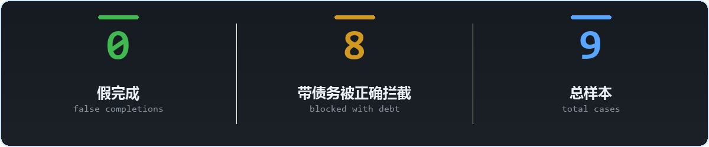

<p align="center">
  
</p>

<p align="center">
  <a href="https://github.com/xianyu-sheng/Xenon/actions/workflows/ci.yml"></a>
  <a href="https://codecov.io/gh/xianyu-sheng/Xenon"></a>
  <a href="https://github.com/xianyu-sheng/Xenon/releases"></a>
  <a href="https://github.com/xianyu-sheng/Xenon/stargazers"></a>
  <a href="LICENSE"></a>
  
</p>

<p align="center">
  <b>模型可以提案，但只有证据才能交付。</b><br>
  <sub>Xenon 把每一步工具执行变成 typed receipt，把每个 claim 绑定到 fact，把无法验证的部分显式变成 debt 或 abstain —— 而不是一句“已完成”。</sub>
</p>

<p align="center">
  <a href="#problem">痛点</a> &nbsp;·&nbsp;
  <a href="#quickstart">快速开始</a> &nbsp;·&nbsp;
  <a href="#demo">演示</a> &nbsp;·&nbsp;
  <a href="#compare">对比</a> &nbsp;·&nbsp;
  <a href="#mechanisms">核心机制</a> &nbsp;·&nbsp;
  <a href="#python-api">Python API</a> &nbsp;·&nbsp;
  <a href="README.en.md">English</a>
</p>

<br>

<a name="problem"></a>


<p>如果你被 AI 编码代理坑过，大概率是下面三种情况：</p>

<table>
<tr>
<td width="33%" bgcolor="#161b22" align="center">
  <br>
  <b>虚假的“已完成”</b><br>
  <sub>代理声称“已修复，测试全过”，但测试根本没跑，或者跑了却失败。</sub>
</td>
<td width="33%" bgcolor="#161b22" align="center">
  <br>
  <b>失败被猜成成功</b><br>
  <sub>工具明明报错，输出里的关键词却被当成成功信号。</sub>
</td>
<td width="33%" bgcolor="#161b22" align="center">
  <br>
  <b>过程无法复盘</b><br>
  <sub>想复盘一次运行，却分不清哪些是说辞、哪些真实发生过。</sub>
</td>
</tr>
</table>

<p>Xenon 不把 LLM 当裁判。模型只输出 capability action，确定性的 gateway 执行并返回 receipt，controller 依据 receipt 决定继续、修复还是阻断；没有证据的交付会被 <code>Finalizer</code> 直接拦下。</p>

<br>

<a name="quickstart"></a>


<p><b>前置要求：Python 3.10–3.12。</b></p>

<p>
   &nbsp;<b>安装（当前版本 v0.9.5，不依赖 PyPI）</b>
</p>

```bash
pip install https://github.com/xianyu-sheng/Xenon/releases/download/v0.9.5/xenon_harness-0.9.5-py3-none-any.whl
```

<p>
   &nbsp;<b>配置凭证（可选，首次运行也会引导）</b>
</p>

<p>提前写好凭证文件 <code>~/.xenon/credentials.yaml</code>（Windows 为 <code>%USERPROFILE%\.xenon\credentials.yaml</code>）：</p>

```yaml
deepseek: "sk-your-deepseek-key"
openai: "sk-your-openai-key"
anthropic: "sk-your-ant-key"
```

<p>
   &nbsp;<b>启动</b>
</p>

```bash
xenon   # 首次运行会引导配置 API Key、模型与运行入口
```

<blockquote>
  <b>关于 PyPI：</b>发布流水线 <code>.github/workflows/pypi-publish.yml</code> 已就绪，正式包上线后即可 <code>pip install xenon-harness</code>；在此之前请使用上面的 Releases 安装方式。
</blockquote>

<p><b>Windows：</b>若出现 <code>'xenon' 不是内部或外部命令</code>，把 pip 输出的 Scripts 目录加入 <code>PATH</code>，或直接用 <code>python -m xenon</code> 启动。</p>

<details>
<summary>从源码运行 / 参与开发</summary>

```bash
git clone --depth 1 https://github.com/xianyu-sheng/Xenon.git
cd Xenon && python -m venv .venv
.venv/Scripts/python -m pip install -e .        # Windows
source .venv/bin/activate && pip install -e .   # Linux / macOS
```

</details>

<p>更多配置、批量执行与工作流用法见 <a href="docs/OPERATION_GUIDE.md">操作手册</a>。</p>

<br>

<a name="demo"></a>


<p align="center">
  <a href="https://github.com/user-attachments/assets/a6cdeb89-fa97-4a5b-b3bf-061690e55008">
    
  </a>
</p>

<p align="center">
  <sub>点击封面即可在线播放 90 秒视频，也可直接使用下方播放器；GIF 备用在更下面。</sub>
</p>

https://github.com/user-attachments/assets/a6cdeb89-fa97-4a5b-b3bf-061690e55008

<p align="center">
  
</p>

<p>最能说明问题的场景：模型声称“测试全部通过”，却拿不出任何 TestRun 回执 —— Xenon 判定 <code>blocked</code> 拒绝交付；直到真实执行并通过验证，<code>Finalizer</code> 才提交。视频的分镜与口播脚本见 <a href="docs/DEMO_SCRIPT.md">DEMO_SCRIPT.md</a>。</p>

<br>

<a name="compare"></a>


<p>一句话：<b>Claude Code 这类代理把工具执行交给模型叙述，Xenon 把工具执行变成可核验的证据。</b></p>

<table>
<tr>
  <th bgcolor="#21262d">维度</th>
  <th bgcolor="#0e4429">Xenon</th>
  <th bgcolor="#21262d">典型 coding agent（Claude Code / Aider / OpenCode 等）</th>
</tr>
<tr>
  <td>完成状态</td>
  <td bgcolor="#12261b">必须绑定真实 receipt，无证据即阻断（fail-closed）</td>
  <td>主要依赖模型自述“已完成”</td>
</tr>
<tr>
  <td>执行记录</td>
  <td bgcolor="#12261b">只追加的哈希链账本，可离线逐字节回放</td>
  <td>给出 diff / 对话记录，无结构化账本</td>
</tr>
<tr>
  <td>失败语义</td>
  <td bgcolor="#12261b">unresolved / ambiguous / abstained 分别处理，从不静默猜测</td>
  <td>工具失败多由模型自行解读</td>
</tr>
<tr>
  <td>交付动作</td>
  <td bgcolor="#12261b"><code>Finalizer</code> 独占提交，审计不过自动回滚</td>
  <td>模型可直接写入或提交</td>
</tr>
<tr>
  <td>模型与扩展</td>
  <td bgcolor="#12261b">12 家厂商 + 本地 Ollama，MCP per-tool 注入</td>
  <td>各家策略不同，闭源产品仅支持自家模型</td>
</tr>
</table>

<p>闭源产品的内部实现不可观测，严谨的逐项对位（含部分支持与已知局限的口径）见 <a href="docs/COMPARISON.md">COMPARISON.md</a>。</p>

<br>

<a name="mechanisms"></a>


<table>
<tr>
<td width="33%" bgcolor="#161b22" align="center">
  <br>
  <b>Evidence receipts</b><br>
  <sub>所有副作用只经过 <code>ToolGateway</code>，返回带类型的 <code>ToolReceipt</code>：exit code、目标匹配、commit sha、worktree delta 都在回执里，而不是在自然语言里。</sub>
</td>
<td width="33%" bgcolor="#161b22" align="center">
  <br>
  <b>Fail-closed verification</b><br>
  <sub>V0 查回执不变量、V1 查步骤后置条件、V2 查全局覆盖；未关闭的债务阻止交付，已被证伪的结果永不接受。</sub>
</td>
<td width="33%" bgcolor="#161b22" align="center">
  <br>
  <b>Replayable ledger</b><br>
  <sub>ledger 是唯一事实源，只有 <code>LoopRuntime</code> 能写入；同一前缀产生逐字节一致的投影，回放零网络、不重放副作用。</sub>
</td>
</tr>
</table>

<br>


<p>针对“代理伪造完成状态”，仓库内置 9 例固定基准（<code>evals/false_completion.py</code>，确定性脚本、零网络）：</p>

<p align="center">
  
</p>

<p>覆盖空转宣称完成、无测试回执却声称通过、漏改义务、游离改动、虚假 push 等情形；健康路径与“用户显式接受缺口（证据等级为 partial）”也在其中，保证基准不是一味阻断。</p>

```bash
python -m evals.false_completion                    # 完整 JSON 报告
pytest tests/test_false_completion_benchmark.py -q  # CI 中的 8 条断言
```

<p>口径与逐用例说明见 <a href="docs/evidence/false-completion/README.md">false-completion 证据</a>。</p>

<br>

<a name="python-api"></a>


```python
import xenon

# 只想要文本结果
answer = xenon.run_task(
    "给 utils.py 里的 parse_config 补类型标注",
    workspace="/path/to/repo",
    engine="react",
    model_priority=["deepseek/deepseek-chat"],
)

# 想要判定结果：accepted / evidence / debt / ledger 路径
outcome = xenon.run_task_result(
    "修复 parser 中的空指针问题",
    workspace="/path/to/repo",
    model_priority=["deepseek/deepseek-chat"],
)

print(outcome.accepted)   # 是否被 harness 接受
print(outcome.evidence)   # 证据等级
print(outcome.debt)       # 未结债务
```

<p>库调用默认绑定工作区围栏，且<b>不产生交付提交</b>——提交权在调用方。完整 API 说明见 <code>xenon/__init__.py</code> 的文档字符串。</p>

<br>


<p>固定协议、逐项冻结、可复现的盲测（单一 <code>react</code> 范式，非多引擎并集 / best-of-N）：</p>

<table>
<tr>
  <th bgcolor="#21262d">样本</th>
  <th bgcolor="#21262d" align="right">通过率</th>
</tr>
<tr>
  <td>SWE-bench Lite 固定 30 例（seed 20260729）</td>
  <td align="right"><b>62.2%</b></td>
</tr>
<tr>
  <td>零重叠留出集（seed 20261016）</td>
  <td align="right"><b>52.2%</b></td>
</tr>
</table>

<ul>
  <li>模型 <code>deepseek-v4-flash</code> 官方 API，判定使用官方 <code>swebench</code> harness；</li>
  <li>3 次独立运行取均值，逐次结果与 sha256 归档公开；</li>
  <li>全仓 <b>4,000+</b> 测试，覆盖 Python 3.10–3.12。</li>
</ul>

<p>完整协议与逐次数据见 <a href="docs/EVAL_RESULTS.md">EVAL_RESULTS.md</a>。30 例子集不是榜单结论，请勿 extrapolate。</p>

<br>


<ul>
  <li><b>路线图</b>：置顶讨论 <a href="https://github.com/xianyu-sheng/Xenon/discussions/143">Roadmap & Feedback #143</a>；</li>
  <li><b>想贡献代码</b>：<a href="https://github.com/xianyu-sheng/Xenon/issues/144">贡献者入口 #144</a> 列了新人友好任务，流程见 <a href="CONTRIBUTING.md">CONTRIBUTING.md</a>；</li>
  <li><b>报缺陷 / 提需求</b>：直接开 <a href="https://github.com/xianyu-sheng/Xenon/issues">Issue</a>（中文 / English 均可），安全问题按 <a href="SECURITY.md">SECURITY.md</a> 私下报告；</li>
  <li><b>行为准则</b>：<a href="CODE_OF_CONDUCT.md">CODE_OF_CONDUCT.md</a>。</li>
</ul>

<p>已被收录：<a href="https://github.com/yzfly/Awesome-MCP-ZH">Awesome-MCP-ZH</a> · <a href="https://github.com/alvinreal/awesome-opensource-ai">awesome-opensource-ai</a> · <a href="https://github.com/collabnix/awesome-mcp-lists">awesome-mcp-lists</a> · <a href="https://github.com/mahmoudsajjadi/awesome-ai-coding-tools">awesome-ai-coding-tools</a></p>

<br>


<p><b>Q：Windows 下提示“xenon 不是内部或外部命令”？</b></p>
<p>用 <code>python -m xenon</code> 启动，或把 pip 的 Scripts 目录加入 <code>PATH</code>。</p>

<p><b>Q：提示“未找到 API Key / 所有模型均调用失败”？</b></p>
<p>检查 <code>~/.xenon/credentials.yaml</code> 是否存在、Key 是否有效；也可用对应环境变量（如 <code>DEEPSEEK_API_KEY</code>）补充，凭证文件优先级更高。</p>

<p><b>Q：对话变长后报 context length 错误？</b></p>
<p>在 REPL 里用 <code>/context</code> 查看用量，<code>/compact</code> 压缩历史。</p>

<p><b>Q：模型说可以交付，Xenon 却拦下来了？</b></p>
<p>这是设计行为。用 <code>/evidence</code> 查看未结债务与 V2 覆盖；确认缺口可接受时显式接受 debt，证据等级会如实标为 partial 而非 verified。</p>

<br>


<table>
<tr>
  <th bgcolor="#21262d">主题</th>
  <th bgcolor="#21262d">文档</th>
</tr>
<tr><td>操作手册 / 故障排除</td><td><a href="docs/OPERATION_GUIDE.md">OPERATION_GUIDE</a></td></tr>
<tr><td>架构与内核（LoopRuntime、I1–I7、ledger）</td><td><a href="docs/ARCHITECTURE.md">ARCHITECTURE</a> · <a href="docs/adr/0001-single-loop-kernel.md">ADR 0001</a></td></tr>
<tr><td>与同类项目对比</td><td><a href="docs/COMPARISON.md">COMPARISON</a></td></tr>
<tr><td>Headless harness</td><td><a href="docs/HARNESS.md">HARNESS</a></td></tr>
<tr><td>扩展开发</td><td><a href="docs/EXTENDING.md">EXTENDING</a></td></tr>
<tr><td>评测协议 / 结果</td><td><a href="docs/XENON_EVAL_PROTOCOL.md">XENON_EVAL_PROTOCOL</a> · <a href="docs/EVAL_RESULTS.md">EVAL_RESULTS</a></td></tr>
<tr><td>演示视频脚本</td><td><a href="docs/DEMO_SCRIPT.md">DEMO_SCRIPT</a></td></tr>
<tr><td>更新日志</td><td><a href="CHANGELOG.md">CHANGELOG</a></td></tr>
</table>

<br>


<ul>
  <li><b>哈希链证明过程，不证明结论。</b>它能发现损坏、单点篡改与重排；防不住有写权限的人整链重算，除非启用可选的 HMAC 锚点。</li>
  <li><b>abstain 是产品行为。</b>无法确定性验证的语义要求不会被包装成 pass。</li>
  <li><b>审批不是 sandbox。</b>外部 MCP server 仍需在受控环境运行，approval 只是调用边界。</li>
  <li><b>SWE-bench 数字有样本和预算限制。</b>请按 EVAL_RESULTS 的协议阅读，不要把 30 例子集当成榜单结论。</li>
</ul>

<br>

<p align="center"><b>MIT License</b></p>
